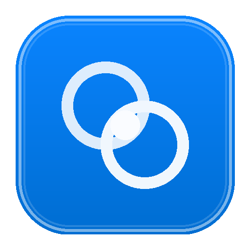

# GlassWidgets for Windows 11

<p align="center">
  
</p>

<p align="center">
  <strong>Native, hardware-accelerated Apple-inspired frosted glass desktop widgets for Windows 11.</strong>
</p>

<p align="center">
  
  
  
  
  
</p>

---

## Overview

**GlassWidgets** brings the clean, physical aesthetic of Apple-inspired liquid glass widgets to the Windows 11 desktop. Running natively via **PySide6 (Qt 6.7+)** and accelerated through **Direct3D 11 RHI**, every widget features real-time Snell-on-a-dome optical refraction, superellipse (squircle) SDF silhouettes, multi-pass Dual Kawase blur, chromatic dispersion, and interactive specular highlights.

---

## ✨ Features

- 🪟 **Optical Liquid Glass Shader:**
  - Real-time refraction through an edge dome with configurable index of refraction (IOR) and dispersion.
  - Multi-stage Dual Kawase pyramid downsample/upsample for artifact-free frosted blur up to 128px reach.
  - Interactive border specular lighting that responds to mouse movement.
  - 100% precompiled `.qsb` shaders (HLSL 50 / GLSL 330) for zero runtime stutter.

- 🎵 **Adaptive Music Player:**
  - Two-way synchronization with Windows **System Media Transport Controls (SMTC)**.
  - Works out of the box with **Spotify, Apple Music, YouTube in Chrome/Edge/Firefox, iTunes, Tidal, and VLC**.
  - Synchronized, live-scrolling lyrics powered by **LRCLIB**.
  - Smooth 3D perspective album-art flip animations and dynamic background color tint extraction.

- ☀️ **Live Weather Widget:**
  - Multi-forecast weather card powered by **Open-Meteo** (no API key required).
  - Current conditions, hourly temperature curve, and 7-day min/max temperature range bars.
  - Adaptive daylight/nighttime color gradients and responsive layout morphing.

- 📅 **Local Calendar:**
  - Standalone, privacy-first **SQLite** calendar engine.
  - Month view, weekend accents, today pill badge, and agenda side-panel expansion (`>= 2:1` ratio).
  - Quick inline event creation and standard `.ics` iCalendar file import.

- ⏰ **World Clocks & Timers:**
  - Analog clocks (classic numbered dial, minimalist marks, rotating hour ring).
  - Timezone world clocks with automatic day/night shading and offset pills (`Yesterday` / `Today` / `Tomorrow`).
  - Digital clock with condensed typography and perimeter tick ring.
  - Countdown timer with quick presets (`1m`, `2m`, `3m`, `5m`), inertial 3D drum wheel picker, and audio chime.

- 💬 **Glass Text & Quotes:**
  - Customizable desktop text tile whose glyph strokes directly refract the desktop wallpaper.

- 🖥️ **Windows 11 Native Integration:**
  - **Wallpaper Refraction:** Event-driven static wallpaper capture via `WM_SETTINGCHANGE` and Windows registry notifications (`Control Panel\Desktop`).
  - **Accent Color Fallback:** Smooth DWM accent color acrylic gradient if a static wallpaper image is not found.
  - **Desktop Surface Mode:** Pin widgets to the desktop background (`HWND_BOTTOM` / Shell `Progman`) so they remain visible during `Win+D` ("Show Desktop").
  - **Per-Monitor V2 DPI Scaling:** Crisp rendering across 100%, 125%, 150%, 175%, and 200% scaling factors.
  - **System Tray Command Center:** Quick manager toggle, edit mode, grid snapping (`Off`, `16px`, `24px`), and widget scale adjustments (`75%` to `200%`).

---

## 📸 Screenshots

<!-- Replace these placeholders with actual screenshots from your desktop -->

| Glass Desktop Layout | Music Player & Synced Lyrics |
|:---:|:---:|
|  |  |

| Weather Forecast & Calendar | GlassWidgets Manager UI |
|:---:|:---:|
|  |  |

---

## 🚀 Installation

### Method 1: Installer (Recommended for Users)

1. Head to the **[Releases](https://github.com/glasswidgets/widgets/releases)** page.
2. Download the latest `GlassWidgets_Setup.exe`.
3. Run the installer and follow the setup wizard.

> [!NOTE]
> **Windows SmartScreen Warning:** Because this is an open-source installer without an expensive commercial code-signing certificate, Windows Defender SmartScreen may display an *"Unknown Publisher"* warning.
>
> To proceed, click **"More info"** and then select **"Run anyway"**.
> All source code is 100% public, inspectable, and reproducible in this repository.

---

### Method 2: Running from Source (For Developers)

#### Prerequisites
- Windows 10 (Build 19041+) or Windows 11
- Python 3.10, 3.11, 3.12, 3.13, or 3.14

#### Setup
```bat
# 1. Clone the repository
git clone https://github.com/glasswidgets/widgets.git
cd widgets

# 2. Install dependencies
pip install -r requirements.txt

# 3. Launch the application
python src/main.py
```
*Alternatively, double-click `run.cmd` for an automated environment check and launch.*

#### Building the Standalone Executable
To package the app into a standalone binary with PyInstaller:
```bat
build_exe.bat
```
The compiled executable will be located at `dist\GlassWidgets.exe`.

#### Building the Setup Installer
To compile the installer using [Inno Setup 6+](https://jrsoftware.org/isdl.php):
```bat
iscc installer.iss
```
The resulting installer will be located at `dist\GlassWidgets_Setup.exe`.

---

## ⚙️ Controls & Usage

- **Manager Window:** Click the `GW` icon in the system notification tray to open the **GlassWidgets Manager**. From here, you can toggle individual widgets, switch styles, adjust grid snap, and manage autostart.
- **Unlock / Edit Mode:** Click **"Unlock / Edit Mode"** in the Manager or tray menu to display 8-directional resize handles and drag-to-move borders on every widget.
- **Widget Scale:** Right-click any widget to open its context menu and scale it from `75%` to `200%`.
- **Desktop Surface:** Enable *"Desktop Surface (Pin Behind Windows)"* in the Manager to anchor widgets below standard applications.

---

## ⚠️ Known Limitations

- **Wallpaper Engine Live Capture:** Continuous live video wallpaper sampling is disabled. Windows DWM composition cannot continuously mirror GPU DirectX swapchains from WorkerW without substantial CPU/GPU overhead. The widgets sample the high-resolution static Windows wallpaper or use a desktop accent color acrylic gradient.
- **Third-Party SMTC Seeking:** Certain third-party music players with non-standard Windows SMTC implementations (e.g. BitChords) may fail to emit timeline position update events during seeking. Normal playback, track changes, and major players (Spotify, Apple Music, Chrome, Firefox) synchronize accurately.

---

## 👏 Credits & Attribution

- **Original QML Widgets & Mathematics:** A massive thank you to [jaxparrow07/liquidglass-kde-widgets](https://github.com/jaxparrow07/liquidglass-kde-widgets) for the original KDE Plasma widget pack, shader logic, and layout designs.
- **Windows Port:** Engineered and ported to Windows 11 using native PySide6, Direct3D 11 RHI, WinRT media integration, and GLSL shaders through an AI-assisted engineering workflow.

---

## 📜 Disclaimer

> GlassWidgets is an independent, open-source project. It is not affiliated with, endorsed by, or sponsored by Apple Inc. "Liquid Glass" and "macOS" are used descriptively to refer to visual styles.

---

## 📄 License

This project is licensed under the **GNU General Public License v3.0 (GPL-3.0)** — see the [LICENSE](LICENSE) file for details.
